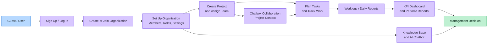
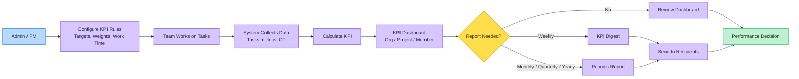
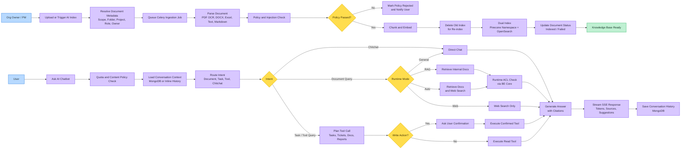

# ICCP Compact Demo Flows

This file is a shorter presentation version of `docs/demo-flows.md`.
Use it when demo time is limited and only the main product flows need to be shown.

Visual convention: actor = blue, process = purple, decision = yellow, success = green.

# Main Features
Mở đầu

Trước khi đi vào các main flow, em sẽ giới thiệu ngắn gọn các actor chính trong hệ thống. Hệ thống gồm 5 nhóm vai trò: Guest/User, System Admin, Organization Admin, Organization Member và Project Manager. Mỗi vai trò sẽ đảm nhiệm một phần khác nhau, từ truy cập thông tin công khai, quản lý tổ chức, quản lý dự án, đến theo dõi công việc, báo cáo và KPI.

Guest/User

Guest/User là người dùng ở giai đoạn đầu. Họ có thể xem landing page công khai của tổ chức, gửi thông tin liên hệ hoặc lead, đăng ký tài khoản, xác thực email, đăng nhập và đặt lại mật khẩu. Ngoài ra, họ có thể nhận lời mời tham gia tổ chức hoặc dự án và xem danh sách các tổ chức mà mình đang tham gia.

System Admin

System Admin là người quản lý toàn bộ nền tảng. Vai trò này có thể quản lý tất cả tổ chức trong hệ thống, xem thông tin chi tiết như owner, thành viên, gói dịch vụ và billing. Ngoài ra, System Admin còn quản lý role, permission cấp hệ thống, các chính sách dùng chung và giám sát hoạt động tổng thể của platform.

Organization Admin

Organization Admin chịu trách nhiệm quản lý một tổ chức cụ thể. Họ có thể cập nhật hồ sơ tổ chức, branding, chatbot và landing page. Đồng thời, họ quản lý thành viên, phân quyền, tài liệu, thư mục, danh mục, quyền truy cập, lead, ticket, báo cáo và KPI ở cấp tổ chức.

Organization Member

Organization Member là người dùng chính bên trong tổ chức. Họ có thể sử dụng chatbot nội bộ để tìm kiếm thông tin và tài liệu, truy cập các tài liệu được phân quyền, tham gia chat nội bộ và nhận thông báo. Ngoài ra, họ có thể tham gia dự án được giao, quản lý task cá nhân, daily report, ticket và KPI của bản thân.

Project Manager

Project Manager tập trung vào quản lý dự án. Họ có thể tạo và quản lý dự án, mời thành viên, phân quyền trong phạm vi dự án, tạo và giao task, cập nhật trạng thái và theo dõi tiến độ. Ngoài ra, Project Manager còn theo dõi dashboard, KPI dự án, KPI thành viên, review daily report, xử lý overtime request và quản lý chat room của dự án.

## Main flow

Phần main flow này tập trung vào các luồng chính của hệ thống ICCP. Thay vì đi sâu vào từng API hay từng màn hình nhỏ, em sẽ trình bày theo hành trình sử dụng.

Ở flow tổng quan, ICCP bắt đầu từ việc người dùng đăng ký hoặc đăng nhập, sau đó tạo mới hoặc tham gia một organization. Chủ doanh nghiệp sẽ thiết lập thành viên, vai trò, quyền hạn và cấu hình hệ thống. Từ đây, team có thể tạo project, phân công công việc và ghi nhận tiến độ. Dữ liệu vận hành sẽ được tổng hợp vào dashboard KPI và periodic report; tài liệu sẽ được quản lý trong knowledge base; còn chatbox đóng vai trò là kênh trao đổi realtime theo ngữ cảnh công việc.

Với luồng project delivery, trọng tâm là cách một dự án được vận hành hằng ngày. Chủ dự án sẽ tạo project, mời thành viên, giao task; thành viên cập nhật tiến độ, log thời gian và gửi daily report. PM xem lại tiến độ, nếu có vấn đề thì có thể xử lý qua ticket hoặc overtime request. Ticket ở đây là phiếu ghi nhận vấn đề hoặc yêu cầu hỗ trợ phát sinh trong dự án để PM theo dõi và xử lý đến khi hoàn tất. Kết quả cuối cùng là trạng thái dự án luôn được cập nhật rõ ràng.

Với KPI và report, hệ thống lấy dữ liệu tính toán chủ yếu từ task như trạng thái hoàn thành, estimated point, deadline, completed time và overtime đã được duyệt. Org Owner hoặc PM cấu hình KPI rules, sau đó hệ thống tự động tính KPI theo cấp organization, project và member. Khi cần tổng hợp, hệ thống có thể gửi KPI digest hằng tuần hoặc periodic report theo tháng, quý, năm cho người nhận phù hợp. Điểm chính của flow này là biến dữ liệu vận hành thành thông tin để ra quyết định.

Với knowledge base và AI chatbot, org owner upload tài liệu và gắn phạm vi truy cập theo organization, project, folder, role hoặc user. Tài liệu được xử lý bất đồng bộ: parse nội dung, kiểm tra content policy, chunk, embed, rồi index vào Pinecone và OpenSearch. Khi người dùng hỏi, chatbot kiểm tra quota, phân loại intent, chọn chế độ general, RAG, auto hoặc web, retrieve dữ liệu có kiểm tra quyền qua BE Core, rồi stream câu trả lời kèm citations, web sources nếu có, gợi ý tiếp theo và lịch sử hội thoại. Ngoài hỏi đáp tài liệu, chatbot còn có thể gọi tool cho project, task, ticket, document, organization và daily report; thao tác ghi sẽ yêu cầu user xác nhận trước khi thực thi.

Cuối cùng là chatbox collaboration. Người dùng mở chatbox, chọn phòng chat như channel, DM hoặc project room, rồi gửi tin nhắn, file, mention hoặc reaction. Hệ thống đẩy realtime update, cập nhật unread và notification, đồng thời hỗ trợ search, pin và mark read. Flow này giúp team trao đổi nhanh ngay trong ngữ cảnh công việc.

Tóm lại, demo flow cho thấy ICCP không chỉ quản lý task riêng lẻ, mà kết nối toàn bộ quá trình làm việc: project delivery, collaboration, knowledge, KPI và report. Mục tiêu là giúp team làm việc tập trung hơn, minh bạch hơn và ra quyết định dựa trên dữ liệu thực tế.

## Main flow

Phần main flow này giới thiệu các nhóm chức năng chính của ICCP và mục đích của từng nhóm trong quá trình vận hành tổ chức. Thay vì trình bày chi tiết từng màn hình hay từng thao tác, phần này giúp người xem hiểu mỗi flow đang giải quyết vấn đề gì và đóng vai trò gì trong toàn bộ hệ thống.

End-to-End Platform Flow thể hiện bức tranh tổng thể của ICCP. Flow này cho thấy hệ thống không chỉ có một chức năng riêng lẻ, mà kết nối nhiều phần như organization, user, role, project, collaboration, knowledge, KPI và report thành một nền tảng vận hành thống nhất cho doanh nghiệp hoặc team.

Project Delivery Flow tập trung vào việc hỗ trợ team vận hành dự án hằng ngày. Mục đích của flow này là giúp project owner, PM và member quản lý công việc rõ ràng hơn, theo dõi tiến độ tốt hơn, xử lý các vấn đề phát sinh và đảm bảo trạng thái dự án luôn minh bạch.

KPI and Reports Flow dùng để biến dữ liệu vận hành thành thông tin quản trị. Thông qua các dữ liệu như task, deadline, effort, progress, overtime và report, hệ thống giúp owner hoặc PM đánh giá hiệu suất ở cấp organization, project và từng member, từ đó có cơ sở để theo dõi và ra quyết định.

Knowledge Base and AI Chatbot Flow tập trung vào việc quản lý và khai thác tri thức nội bộ. Flow này giúp tổ chức lưu trữ tài liệu có phân quyền, cho phép người dùng tìm kiếm thông tin nhanh hơn, hỏi đáp theo ngữ cảnh công việc và sử dụng AI như một trợ lý hỗ trợ trong quá trình làm việc.

Chatbox Collaboration Flow đóng vai trò là kênh trao đổi realtime trong ICCP. Mục đích của flow này là giúp team giao tiếp nhanh trong các channel, DM hoặc project room, đồng thời giữ việc trao đổi gắn với ngữ cảnh công việc thay vì bị tách rời sang công cụ bên ngoài.

Tóm lại, main flow giúp người xem hiểu ICCP là một nền tảng hỗ trợ vận hành tổng thể, không chỉ dừng lại ở quản lý task. Các flow chính liên kết với nhau để giúp team làm việc tập trung hơn, phối hợp hiệu quả hơn, minh bạch hơn và ra quyết định dựa trên dữ liệu thực tế.

## 1. End-to-End Platform Flow

## 2. Project Delivery Flow

```mermaid
flowchart LR
 A[Org Admin / PM] --> B[Create Project]
 B --> C[Invite Team]
 C --> D[Create and Assign Tasks]
 D --> E[Member Updates Progress]
 E --> F[Log Work<br/>and Submit Daily Report]
 F --> G[PM Reviews Progress]
 G --> H{Needs Support?}
 H -->|Yes| I[Ticket / Overtime Request]
 H -->|No| J[Continue Delivery]
 I --> J
 J --> K[Project Status Updated]

 classDef actor fill:#b7d9ff,stroke:#5d9ee8,stroke-width:2px,color:#263238;
 classDef process fill:#d8c7ff,stroke:#9b7cf2,stroke-width:2px,color:#2f2840;
 classDef decision fill:#ffdd4d,stroke:#e6b800,stroke-width:2px,color:#3a3000;
 classDef success fill:#bff0d2,stroke:#62c98b,stroke-width:2px,color:#123524;

 class A actor;
 class B,C,D,E,F,G,I,J process;
 class H decision;
 class K success;
```

## 3. KPI and Reports Flow

## 4. Knowledge Base and AI Chatbot Flow

## 5. Chatbox Collaboration Flow

```mermaid
flowchart LR
 A[User] --> B[Open Chatbox]
 B --> C[Choose Room<br/>Channel, DM, Project]
 C --> D{Room Exists?}
 D -->|No| E[Create / Join / Invite]
 D -->|Yes| F[Open Room]
 E --> F
 F --> G[Send Message<br/>Attachment, Mention, Reaction]
 G --> H[Realtime Update]
 H --> I[Unread / Notification]
 I --> J[Search, Pin, or Mark Read]

 classDef actor fill:#b7d9ff,stroke:#5d9ee8,stroke-width:2px,color:#263238;
 classDef process fill:#d8c7ff,stroke:#9b7cf2,stroke-width:2px,color:#2f2840;
 classDef decision fill:#ffdd4d,stroke:#e6b800,stroke-width:2px,color:#3a3000;
 classDef success fill:#bff0d2,stroke:#62c98b,stroke-width:2px,color:#123524;

 class A actor;
 class B,C,E,F,G,H,I process;
 class D decision;
 class J success;
```

