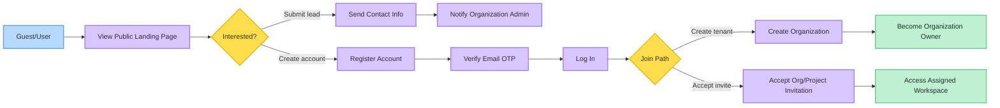
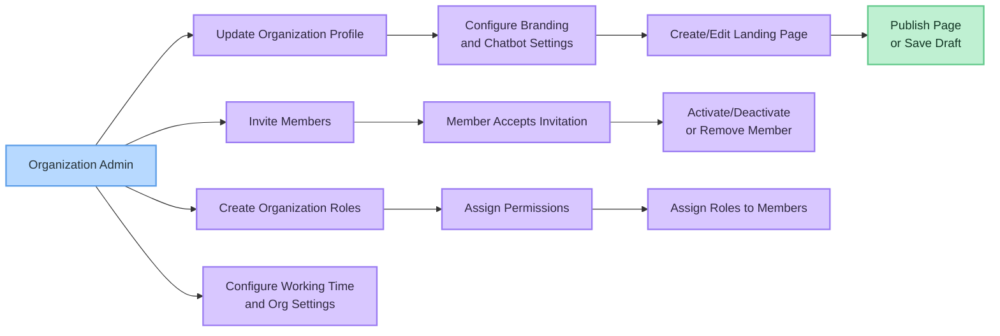
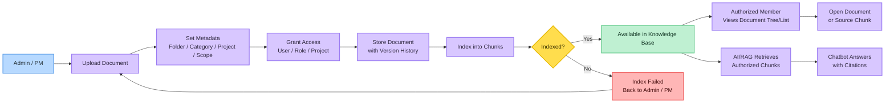
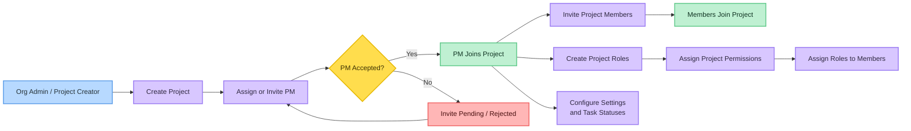
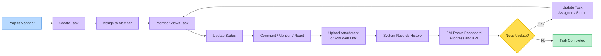
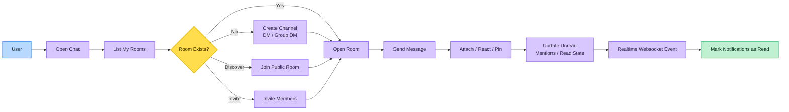
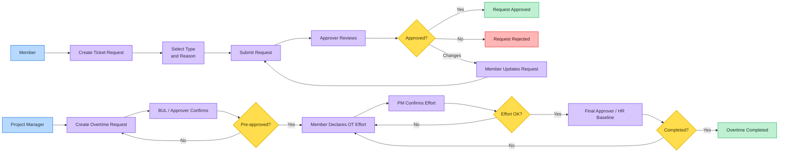
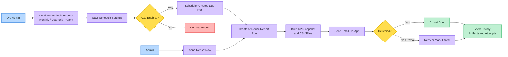
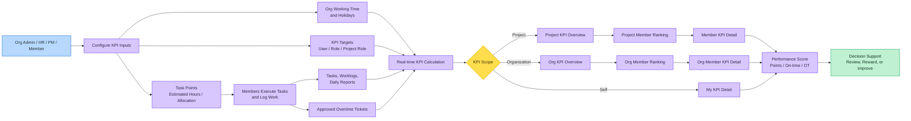

# ICCP Demo Flows

These Mermaid diagrams summarize the main product flows found in the backend modules. 
Visual convention: actor = blue, process = purple, decision = yellow, success = green, failure/return = red.

## 1. Guest to Organization Onboarding

## 2. Organization Admin Setup

## 3. Document and Knowledge Management

## 4. Project Setup and Team Assignment

## 5. Task Execution Flow

## 6. Worklog and Daily Report Flow

```mermaid
flowchart LR
 A[Organization Member] --> B[Work on Assigned Task]
 B --> C[Create Task Worklog]
 C --> D[Update Actual Logged Time]
 D --> E[Open My Daily Report]
 E --> F[Generate Draft<br/>from Worklogs]
 F --> G[Edit Summary<br/>Blockers / Tomorrow Plan]
 G --> H[Submit Daily Report]
 H --> I[Notify Project Manager]
 I --> J[PM Reviews Report]
 J --> K{Review Action}
 K -->|Comment| L[Add Review Comment]
 K -->|Seen| M[Mark as Seen]
 L --> N[Notify Member]
 M --> N

 classDef actor fill:#b7d9ff,stroke:#5d9ee8,stroke-width:2px,color:#263238;
 classDef process fill:#d8c7ff,stroke:#9b7cf2,stroke-width:2px,color:#2f2840;
 classDef decision fill:#ffdd4d,stroke:#e6b800,stroke-width:2px,color:#3a3000;
 classDef success fill:#bff0d2,stroke:#62c98b,stroke-width:2px,color:#123524;

 class A actor;
 class B,C,D,E,F,G,H,I,J,L,N process;
 class K decision;
 class M success;
```

## 7. Internal Chat and Notification Flow

## 8. Ticket Request and Overtime Flow

## 9. Periodic Report Flow

## 10. KPI Analytics Flow

