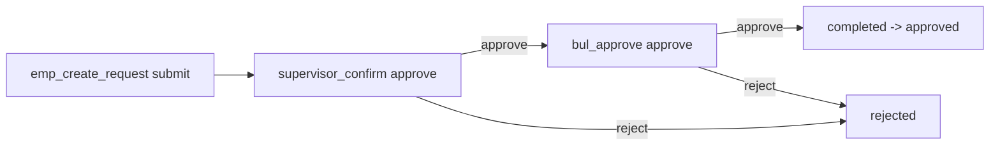
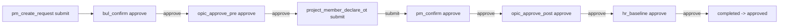
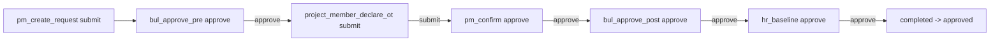

# Ticket Request Enterprise - FE Implementation Guide

Tai lieu nay la ban FE implementation guide da doi chieu truc tiep voi backend hien tai:
- `src/modules/organization/ticket-request/ticket-request.controller.ts`
- `src/modules/organization/ticket-request/ticket-request.service.ts`
- `src/modules/organization/ticket-request/constants/request-type-catalog.constant.ts`
- `src/modules/organization/ticket-request/entities/ticket-request.entity.ts`

Muc tieu: FE implement dung flow enterprise moi, dung request/response contract va khong hard-code sai state machine.

## 1) Base config

- Base URL: `/api/v1`
- Module path: `/ticket-requests`
- Auth header: `Authorization: Bearer <access_token>`
- Tenant header bat buoc: `x-organization-id: <organization_uuid>`

Tat ca endpoint tra ve envelope `ApiResponseDto<T>`:

```json
{
  "statusCode": 200,
  "message": "string",
  "data": {}
}
```

## 2) Permission map theo endpoint

- `POST /ticket-requests`: `ticket_requests.create`
- `GET /ticket-requests/my`: `ticket_requests.list_own`
- `GET /ticket-requests/manage`: `ticket_requests.list_org`
- `GET /ticket-requests/request-types`: `ticket_requests.create`
- `GET /ticket-requests/reason-options`: `ticket_requests.create`
- `GET /ticket-requests/approver-options`: `ticket_requests.create`
- `GET /ticket-requests/:ticketId`: `ticket_requests.view`
- `PATCH /ticket-requests/:ticketId`: `ticket_requests.update_own`
- `POST /ticket-requests/:ticketId/cancel`: `ticket_requests.cancel_own`
- `POST /ticket-requests/:ticketId/approve`: `ticket_requests.approve`
- `POST /ticket-requests/:ticketId/reject`: `ticket_requests.approve`
- `POST /ticket-requests/:ticketId/request-changes`: `ticket_requests.approve`
- `GET /ticket-requests/:ticketId/comments`: `ticket_requests.view`
- `POST /ticket-requests/:ticketId/comments`: `ticket_requests.comment`
- `POST /ticket-requests/:ticketId/cc-members`: `ticket_requests.view` + rule manage CC trong service
- `DELETE /ticket-requests/:ticketId/cc-members/:memberId`: `ticket_requests.view` + rule manage CC trong service

## 3) Core enum/state keys FE bat buoc dung

FE phai render action dua tren bo 3 field:
- `workflowCode`
- `currentStepCode`
- `status`

Khong duoc chi dua vao `status`.

### 3.1 Ticket type (coarse)
- `leave`
- `wfh`
- `overtime`
- `advance`
- `general`

### 3.2 Workflow code
- `working_time`
- `overtime_opic`
- `overtime_standard`

### 3.3 Ticket status
- `pending_approval`: dang cho step approve xu ly
- `changes_requested`: dang o step submit, cho nguoi submit cap nhat/resubmit
- `approved`: da ket thuc thanh cong
- `rejected`: ket thuc bi reject terminal
- `canceled`: requester da huy

### 3.4 Workflow step code
- `emp_create_request`
- `supervisor_confirm`
- `bul_approve`
- `pm_create_request`
- `bul_confirm`
- `opic_approve_pre`
- `project_member_declare_ot`
- `pm_confirm`
- `opic_approve_post`
- `bul_approve_pre`
- `bul_approve_post`
- `hr_baseline`
- `completed`
- `rejected`
- `canceled`

### 3.5 Activity action code
- `created`
- `submitted`
- `updated`
- `approved`
- `rejected`
- `changes_requested`
- `canceled`
- `commented`
- `cc_added`
- `cc_removed`

## 4) Catalog APIs cho dropdown Request Type/Reason

FE phai load runtime tu backend, khong hard-code list.

### 4.1 Request Type catalog

- Endpoint: `GET /api/v1/ticket-requests/request-types`
- Response item:
- `code`
- `label`
- `type`
- `allowedWorkflowCodes`
- `defaultWorkflowCode`

Example:

```json
{
  "code": "overtime_request",
  "label": "Overtime request",
  "type": "overtime",
  "allowedWorkflowCodes": ["overtime_standard", "overtime_opic"],
  "defaultWorkflowCode": "overtime_standard"
}
```

### 4.2 Reason catalog

- Endpoint: `GET /api/v1/ticket-requests/reason-options`
- Response item:
- `code`
- `label`


### 4.3 Approver options cho dropdown Approver

- Endpoint: `GET /api/v1/ticket-requests/approver-options`
- Chi tra ve active organization members co permission `ticket_requests.approve`.
- Response item:
- `id`, `email`, `firstName`, `lastName`
- `isOrgAdmin`: user co role organization admin
- `isDefault`: backend de `true` cho option default

Response item example:

```json
{
  "id": "307f0059-51fa-43ea-b1dc-a9629ca1389f",
  "email": "admin@iccp.ai",
  "firstName": "Tran",
  "lastName": "Linh",
  "isOrgAdmin": true,
  "isDefault": true
}
```

Rule default approver:
- Neu requester KHONG co permission `ticket_requests.approve`: backend tra `isDefault=false` cho toan bo option.
- Neu requester CO permission `ticket_requests.approve`: backend chon 1 org admin trong approver list va set `isDefault=true`.
- FE nen uu tien pre-select item co `isDefault=true`; neu khong co thi fallback item dau tien.

### 4.4 Validation rule backend theo catalog

- `requestTypeCode` phai ton tai trong catalog.
- `reasonCode` (neu gui) phai ton tai trong reason catalog.
- `workflowCode` (neu gui o create) phai nam trong `allowedWorkflowCodes` cua request type.
- Neu gui ca `type` va `requestTypeCode`, backend check consistency.

## 5) Create form mapping cho FE

### 5.1 Fields va mapping

| UI field | API field | Required backend | Notes |
| --- | --- | --- | --- |
| Request Type | `requestTypeCode` | Yes | Nen bind theo `code` tu catalog |
| Request Type (coarse, optional) | `type` | No | Chi de backward compatibility; neu gui phai match `requestTypeCode` |
| Workflow | `workflowCode` | No | Neu bo qua, backend lay `defaultWorkflowCode` tu request type |
| Title | `title` | Yes | Max 255 |
| Content | `content` | Yes | text |
| Reason | `reasonCode` | No | UI co the bat buoc theo business, backend dang cho optional |
| Reason detail | `reasonDetail` | No | text |
| Priority | `priority` | No | `low | normal | high`, default `normal` |
| Approver | `approverId` | Yes | Khong duoc trung `requester`, va bat buoc user co permission `ticket_requests.approve` |
| Effort owner | `effortOwnerId` | No | Default = requester |
| CC members | `ccMemberIds` | No | Max 50; backend tu loai requester/approver/effortOwner va auto add org admin lam default CC |
| Start datetime | `startAt` | No | ISO string |
| End datetime | `endAt` | No | ISO string; neu co ca 2 thi `startAt <= endAt` |

### 5.2 Submit button rule de tranh loi 400/409

- Bat buoc co `requestTypeCode`, `title`, `content`, `approverId`.
- Neu co `startAt` va `endAt` thi validate range tren FE truoc submit.
- Neu cho user chon workflow, chi cho chon workflow nam trong `allowedWorkflowCodes`.

## 6) Data contract FE can rely on

### 6.1 Summary response item

```json
{
  "id": "uuid",
  "code": "TR-20260315-123456",
  "type": "overtime",
  "workflowCode": "overtime_opic",
  "currentStepCode": "pm_confirm",
  "currentStepOrder": 4,
  "requestTypeCode": "overtime_request",
  "requestTypeName": "Overtime request",
  "reasonCode": "project_deadline",
  "title": "OT sprint 12",
  "status": "pending_approval",
  "priority": "normal",
  "requester": {
    "id": "uuid",
    "email": "user@iccp.ai",
    "firstName": "Nguyen",
    "lastName": "An"
  },
  "approver": {
    "id": "uuid",
    "email": "lead@iccp.ai",
    "firstName": "Tran",
    "lastName": "Binh"
  },
  "createdAt": "2026-03-15T08:00:00.000Z",
  "updatedAt": "2026-03-15T08:30:00.000Z"
}
```

### 6.2 Detail response fields bo sung

- `content`
- `reasonDetail`
- `effortOwner`
- `startAt`, `endAt`
- `decisionNote`, `decidedAt`, `decidedBy`
- `canceledAt`, `canceledBy`
- `ccMembers[]`
- `activities[]`

`activities[].payload` co the co:
- `fromStepCode`
- `toStepCode`
- `nextApproverId`
- `stagedApproverId`
- `reason`
- `note`
- `fields`
- `commentId`
- `memberIds`
- `memberId`

## 7) API details (request + business rule)

### 7.0 Get approver options

- Endpoint: `GET /api/v1/ticket-requests/approver-options`
- Success code: `200`
- Dung de load dropdown Approver cho man hinh create/update.
- Danh sach da duoc backend filter theo permission `ticket_requests.approve`.
- Co metadata FE can dung ngay:
- `isOrgAdmin`
- `isDefault`

Response envelope example:

```json
{
  "statusCode": 200,
  "message": "Fetched approver options successfully",
  "data": [
    {
      "id": "307f0059-51fa-43ea-b1dc-a9629ca1389f",
      "email": "admin@iccp.ai",
      "firstName": "Tran",
      "lastName": "Linh",
      "isOrgAdmin": true,
      "isDefault": true
    }
  ]
}
```

FE mapping khuyen nghi:
- Build dropdown tu `data[]`.
- Tim item `isDefault=true` de set `approverId` mac dinh.
- Van cho user doi approver trong list, vi backend chi enforce permission + membership.

### 7.1 Create ticket

- Endpoint: `POST /api/v1/ticket-requests`
- Success code: `201`

Request body example:

```json
{
  "requestTypeCode": "overtime_request",
  "workflowCode": "overtime_opic",
  "title": "OT sprint 12",
  "content": "Need support release",
  "reasonCode": "project_deadline",
  "reasonDetail": "Peak workload before go-live",
  "priority": "normal",
  "approverId": "307f0059-51fa-43ea-b1dc-a9629ca1389f",
  "effortOwnerId": "6fdf6ffc-ed77-94fa-407e-a7b86ed9e59d",
  "ccMemberIds": ["11111111-1111-1111-1111-111111111111"],
  "startAt": "2026-03-20T08:00:00.000Z",
  "endAt": "2026-03-20T17:00:00.000Z"
}
```

Rule:
- Tao xong se auto dat `status=pending_approval`.
- `approverId` bat buoc la user co permission `ticket_requests.approve`.
- `currentStepCode` duoc dat vao gate approve dau tien cua workflow.

### 7.2 List my tickets

- Endpoint: `GET /api/v1/ticket-requests/my`
- Success code: `200`
- Scope: requester, current approver, effort owner, cc member.

Supported query:
- `page`, `limit`, `sortBy`, `sortOrder`
- `status`, `type`, `workflowCode`, `currentStepCode`
- `requestTypeCode`, `requesterId`, `approverId`
- `search`, `fromDate`, `toDate`

Sort field hop le:
- `createdAt`
- `updatedAt`
- `status`

### 7.3 List manage tickets

- Endpoint: `GET /api/v1/ticket-requests/manage`
- Success code: `200`
- Scope: toan organization (manager screens).
- Query giong endpoint `my`.

### 7.4 Get ticket detail

- Endpoint: `GET /api/v1/ticket-requests/:ticketId`
- Success code: `200`

### 7.5 Update + resubmit (chi cho submit-step)

- Endpoint: `PATCH /api/v1/ticket-requests/:ticketId`
- Success code: `200`

Request body fields (all optional):
- `type`
- `requestTypeCode`
- `requestTypeName`
- `title`
- `content`
- `reasonCode`
- `reasonDetail`
- `priority`
- `ccMemberIds`
- `nextApproverId`
- `startAt`
- `endAt`

Rule:
- Chi duoc goi khi `status=changes_requested`.
- `currentStepCode` phai la submit-step:
- `emp_create_request` (submitter = requester)
- `pm_create_request` (submitter = requester)
- `project_member_declare_ot` (submitter = effortOwner, fallback requester)
- `nextApproverId` (neu gui) bat buoc la user co permission `ticket_requests.approve`.
- Sau resubmit:
- step nhay sang next approve step
- `status` ve `pending_approval`
- Workflow khong doi o endpoint nay.

### 7.6 Cancel ticket

- Endpoint: `POST /api/v1/ticket-requests/:ticketId/cancel`
- Success code: `200`

Rule:
- Chi requester duoc huy.
- Chi huy khi status dang `pending_approval` hoac `changes_requested`.
- Sau huy: `status=canceled`, `currentStepCode=canceled`.

### 7.7 Approve current step

- Endpoint: `POST /api/v1/ticket-requests/:ticketId/approve`
- Success code: `200`

Request body:

```json
{
  "note": "Approved",
  "nextApproverId": "307f0059-51fa-43ea-b1dc-a9629ca1389f"
}
```

Rule:
- Chi assigned approver hien tai hoac org manager co quyen process.
- Ticket phai dang `pending_approval`.
- Current step phai la approve-step.
- `nextApproverId` (neu gui) bat buoc la user co permission `ticket_requests.approve`.
- Neu next step la approve-step:
- giu `status=pending_approval`
- co the override nguoi duyet bang `nextApproverId`
- Neu next step la submit-step:
- dat `status=changes_requested`
- submitter buoc tiep theo se cap nhat/resubmit
- Neu khong con next step:
- dat `status=approved`
- `currentStepCode=completed`

### 7.8 Reject current step

- Endpoint: `POST /api/v1/ticket-requests/:ticketId/reject`
- Success code: `200`

Request body:

```json
{
  "reason": "Not valid",
  "nextApproverId": "307f0059-51fa-43ea-b1dc-a9629ca1389f"
}
```

Rule:
- Working Time (`supervisor_confirm`, `bul_approve`) reject la terminal:
- `status=rejected`
- `currentStepCode=rejected`
- Overtime flows reject la send-back:
- `status=changes_requested`
- target step theo route cua workflow
- `nextApproverId` duoc luu de dung cho gate approve sau khi resubmit
- `nextApproverId` (neu gui) bat buoc co permission `ticket_requests.approve`.

### 7.9 Request changes

- Endpoint: `POST /api/v1/ticket-requests/:ticketId/request-changes`
- Success code: `200`

Request body:

```json
{
  "reason": "Please update details",
  "nextApproverId": "307f0059-51fa-43ea-b1dc-a9629ca1389f"
}
```

Rule:
- Ticket phai dang `pending_approval`.
- Current step phai la approve-step.
- Luon send-back ve submit-step theo mapping ben duoi.
- `nextApproverId` (neu gui) bat buoc co permission `ticket_requests.approve`.

### 7.10 Comments

- `GET /api/v1/ticket-requests/:ticketId/comments` -> `200`
- `POST /api/v1/ticket-requests/:ticketId/comments` -> `201`

Create comment body:

```json
{
  "content": "Da cap nhat thong tin."
}
```

`content` max length: `5000`.

### 7.11 CC members

- `POST /api/v1/ticket-requests/:ticketId/cc-members` -> `200`
- `DELETE /api/v1/ticket-requests/:ticketId/cc-members/:memberId` -> `200`

Add CC body:

```json
{
  "memberIds": [
    "307f0059-51fa-43ea-b1dc-a9629ca1389f",
    "6fdf6ffc-ed77-94fa-407e-a7b86ed9e59d"
  ]
}
```

Rule manage CC:
- Actor hop le neu la requester, approver, effortOwner.
- Hoac user co permission `ticket_requests.manage_cc`.
- Organization admin duoc auto them vao CC mac dinh, khong can add thu cong.
- FE khong nen cho remove org admin khoi CC list.

## 8) Workflow transitions (source of truth: service workflow definitions)

## 8.1 Working Time



Reject route:
- `supervisor_confirm` -> terminal rejected
- `bul_approve` -> terminal rejected

Request-changes route:
- from any approve step -> `emp_create_request` (`changes_requested`)

## 8.2 Overtime OPIC



Reject route:
- `bul_confirm` -> `pm_create_request`
- `opic_approve_pre` -> `pm_create_request`
- `pm_confirm` -> `project_member_declare_ot`
- `opic_approve_post` -> `project_member_declare_ot`
- `hr_baseline` -> `project_member_declare_ot`

Request-changes route:
- `bul_confirm`, `opic_approve_pre` -> `pm_create_request`
- `pm_confirm`, `opic_approve_post`, `hr_baseline` -> `project_member_declare_ot`

## 8.3 Overtime Standard



Reject route:
- `bul_approve_pre` -> `pm_create_request`
- `pm_confirm` -> `project_member_declare_ot`
- `bul_approve_post` -> `project_member_declare_ot`
- `hr_baseline` -> `project_member_declare_ot`

Request-changes route:
- `bul_approve_pre` -> `pm_create_request`
- `pm_confirm`, `bul_approve_post`, `hr_baseline` -> `project_member_declare_ot`

## 9) FE action matrix

- Show `Approve / Reject / Request changes` when:
- `status === "pending_approval"`
- user la assigned approver hien tai hoac manager screen co permission process

- Show `Submit update` when:
- `status === "changes_requested"`
- va user dung submitter theo `currentStepCode`

- Show `Cancel` when:
- user la requester
- va status trong `pending_approval | changes_requested`

- Show `Manage CC` when:
- user la requester/approver/effortOwner
- hoac co permission `ticket_requests.manage_cc`

## 10) Full request type catalog (current backend)

| Code | Label | Type | Allowed workflow |
| --- | --- | --- | --- |
| `work_from_home` | Work from home | `wfh` | `working_time` |
| `late_coming` | Late coming | `general` | `working_time` |
| `early_leave` | Early leave | `general` | `working_time` |
| `paid_leave` | Paid leave | `leave` | `working_time` |
| `paid_leave_last_year` | Paid leave of last year | `leave` | `working_time` |
| `compensation_leave` | Compensation leave | `leave` | `working_time` |
| `sick_leave_with_hospital_paper` | Sick leave (with hospital paper) | `leave` | `working_time` |
| `waive_tracking_late_coming_early_leave` | Waive tracking on standard Late coming, Early leave | `general` | `working_time` |
| `summer_vacation_leave` | Summer Vacation leave | `leave` | `working_time` |
| `unpaid_leave` | Unpaid leave | `leave` | `working_time` |
| `contract_suspension` | Contract suspension | `leave` | `working_time` |
| `leave_taking_care_of_sick_children` | Leave for taking care of sick children | `leave` | `working_time` |
| `marital_leave` | Marital leave | `leave` | `working_time` |
| `leave_long_term_sickness_treatment` | Leave for long term sickness treatment | `leave` | `working_time` |
| `funeral_leave_parent_helpmate_children` | Funeral leave (Parent, Helpmate, Children) | `leave` | `working_time` |
| `paternity_leave_spouse_natural_birth_one_child` | Maternity leave for male employees (in case the spouse gives natural birth to one child) | `leave` | `working_time` |
| `paternity_leave_spouse_childbirth_operation_or_two_children` | Maternity leave for male employees (in case the spouse takes childbirth operation or gives birth to two children) | `leave` | `working_time` |
| `paternity_leave_spouse_natural_birth_twins` | Maternity leave for male employees (in case the spouse gives natural birth to twins) | `leave` | `working_time` |
| `paternity_leave_spouse_natural_birth_triplets` | Maternity leave for male employees (in case the spouse gives natural birth to triplets) | `leave` | `working_time` |
| `paternity_leave_spouse_twins_or_more_and_operation` | Maternity leave for male employees (in case the spouse gives birth to twins or more and takes childbirth operation) | `leave` | `working_time` |
| `adoption_leave_under_6_month_child` | Maternity leave for Employees adopting an under-6-month child | `leave` | `working_time` |
| `leave_for_taking_contraceptive_measures` | Leave for taking contraceptive measures | `leave` | `working_time` |
| `convalescence_rehabilitation_after_illness` | Convalescence rehabilitation after illness | `leave` | `working_time` |
| `part_time_waive_tracking_office_time` | Part time - Waive Tracking Office Time | `general` | `working_time` |
| `part_time_tracking_office_time` | Part time - Tracking Office Time | `general` | `working_time` |
| `holidays_for_expats` | Holidays for expats | `leave` | `working_time` |
| `examination_for_military_service_leave` | Examination for military service leave | `leave` | `working_time` |
| `leave_due_to_wife_miscarriage_from_22_weeks_onwards` | Leave due to wife's miscarriage from 22 weeks of pregnancy onwards | `leave` | `working_time` |
| `overtime_request` | Overtime request | `overtime` | `overtime_standard`, `overtime_opic` |
| `advance_salary` | Advance salary request | `advance` | `working_time` |
| `general_request` | General request | `general` | `working_time` |

## 11) Reason catalog (current backend)

| Code | Label |
| --- | --- |
| `personal_reason` | Personal reason |
| `family_reason` | Family reason |
| `medical_reason` | Medical reason |
| `medical_treatment` | Medical treatment |
| `child_care` | Child care |
| `marriage_reason` | Marriage / family event |
| `funeral_reason` | Funeral event |
| `military_reason` | Military obligation |
| `maternity_paternity` | Maternity / paternity |
| `annual_leave` | Annual leave |
| `annual_leave_plan` | Annual leave plan |
| `unpaid_leave_reason` | Unpaid leave reason |
| `compensation_leave_reason` | Compensation leave reason |
| `project_deadline` | Project deadline / workload peak |
| `office_schedule_adjustment` | Office schedule adjustment |
| `policy_exception` | Policy exception |
| `other` | Other |

## 12) Error handling map cho FE

- `400`: validation fail (enum, uuid, body, requestType/reason khong support, date range sai)
- `403`: actor/scope/permission khong hop le
- `409`: sai state transition (approve/reject/request-changes/cancel/update khong dung status/step)

## 13) FE implementation checklist nhanh

- Luon load dropdown tu catalog endpoints.
- Render action button bang `workflowCode + currentStepCode + status`.
- Co nhan dien submitter step:
- `emp_create_request` -> requester
- `pm_create_request` -> requester
- `project_member_declare_ot` -> effortOwner (fallback requester)
- Khi send-back/reject/request-changes, luu y ticket ve `changes_requested`.
- Khong cho doi `workflowCode` trong luong resubmit (PATCH).


## 14) Realtime websocket (ticket-request)

Backend da emit realtime qua namespace `notifications` cho ticket-request:

- `notification.new`: duoc phat khi backend tao in-app notification cho user lien quan ticket.
- `ticket-request.updated`: duoc phat cho user lien quan moi khi ticket co thay doi (create/resubmit/approve/reject/request-changes/cancel/comment/cc add/cc remove).

Payload `ticket-request.updated`:

```json
{
  "ticketId": "uuid",
  "code": "TR-20260316-123456",
  "organizationId": "uuid",
  "action": "approved",
  "actorId": "uuid",
  "status": "pending_approval",
  "currentStepCode": "pm_confirm",
  "title": "[Ticket TR-20260316-123456] Step approved",
  "message": "A workflow step was approved and moved to next approval gate.",
  "data": {
    "module": "ticket_request"
  },
  "occurredAt": "2026-03-16T08:00:00.000Z"
}
```

FE khuyen nghi:
- Lang nghe `ticket-request.updated` de refresh list/detail ticket theo `ticketId`.
- Lang nghe `notification.new` de cap nhat notification badge/realtime toast.

