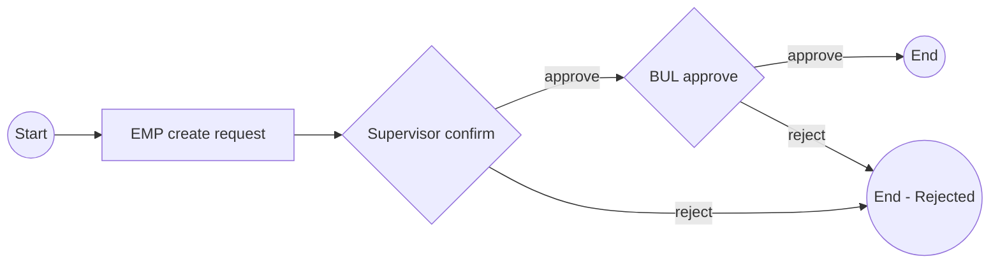
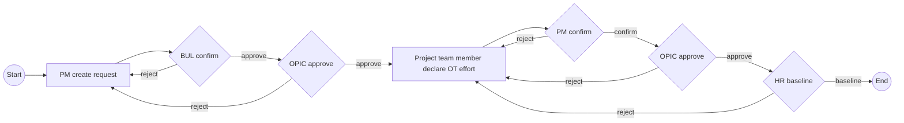

# Ticket Request - Enterprise Workflow Draft (from screenshots)

Tai lieu nay duoc tao tu cac screenshot ban cung cap de chot flow muc tieu cho Ticket Request doanh nghiep.
Muc tieu: co 1 ban spec de review truoc khi map vao backend implementation.

## 1) Scope va actor

- Scope UI nhin thay: Dashboard + modal Workflow + man hinh Create New Request.
- Actor nhin thay trong flow: `EMP`, `Supervisor`, `BUL`, `PM`, `OPIC`, `Project Team Member`, `SSC-HR`.
- Co 3 nhom flow theo tab: `Working Time`, `Overtime OPIC Flow`, `Overtime`.

## 2) Working Time flow (tu screenshot 1)



Rule:
- Request duoc tao boi nhan vien (`EMP`).
- Qua 2 gate: `Supervisor confirm` -> `BUL approve`.
- Reject tai `Supervisor` hoac `BUL` thi ket thuc voi trang thai rejected.

## 3) Overtime OPIC flow (bien the co OPIC - tu screenshot 2)



Rule:
- Phase 1 (pre-check truoc khi lam OT): `PM create` -> `BUL confirm` -> `OPIC approve`.
- Neu reject o phase 1 thi quay ve buoc `PM create request`.
- Phase 2 (sau khi da lam OT): `team member declare OT effort` -> `PM confirm` -> `OPIC approve` -> `HR baseline`.
- Neu reject o phase 2 thi quay lai buoc `declare OT effort` de sua/khai bao lai.

## 4) Overtime flow (bien the khong hien OPIC trong gate - tu screenshot 3)

Screenshot 3 cho thay bien the OT voi gate `Approver (BUL)` thay vi gate `OPIC` trong phase sau.

```mermaid
flowchart LR
  START((Start)) --> PM_CREATE[PM create request]
  PM_CREATE --> BUL_1{Approver (BUL)}
  BUL_1 -->|approve| DECLARE[Project team member declare OT effort]
  BUL_1 -->|reject| PM_CREATE

  DECLARE --> PM_CONFIRM{PM confirm}
  PM_CONFIRM -->|confirm| BUL_2{Approver (BUL)}
  BUL_2 -->|approve| HR_BASELINE{SSC-HR baseline}
  HR_BASELINE -->|baseline| END((End))

  PM_CONFIRM -->|reject| DECLARE
  BUL_2 -->|reject| DECLARE
  HR_BASELINE -->|reject| DECLARE
```

Rule:
- Co 2 lan approve boi `BUL` (truoc va sau khai bao OT effort).
- Reject o gate dau quay ve `PM create`.
- Reject o phase sau quay ve `declare OT effort`.

## 5) UI behavior tren Create New Request (tu screenshot 4 -> 8)

Quan sat chinh:
- Co 2 khoi chinh: `Request Details` (trai) va `Approval Status` (phai).
- Truong bat buoc nhin thay: `Request Type`, `Reason`, `Approver`.
- Nut `Submit` disable khi chua du dieu kien.
- Dashboard co entry point rieng `Create OT Request`.

Danh sach Request Type nhin thay trong dropdown (khong chac da day du):
- Work from home
- Late coming
- Early leave
- Paid leave
- Paid leave of last year
- Compensation leave
- Sick leave (with hospital paper)
- Waive tracking on standard Late coming, Early leave
- Summer Vacation leave
- Unpaid leave
- Contract suspension
- Leave for taking care of sick children
- Marital leave
- Leave for long term sickness treatment
- Funeral leave (Parent, Helpmate, Children)
- Nhom maternity leave cho nam / nhan con nuoi (nhieu bien the)

## 6) Mapping voi backend hien tai (de planning implementation)

Backend `iccp_backend_core` hien tai dang co:
- `TicketRequestType`: `leave | wfh | overtime | advance | general`
- `TicketRequestStatus`: `pending_approval | changes_requested | approved | rejected | canceled`
- Flow thuc thi hien tai la 1 approver chain don (khong phan tach step workflow nhu screenshot doanh nghiep).

Khoang cach so voi flow enterprise:
- Can support multi-step approval chain theo workflow.
- Can support reject-route khac nhau (ket thuc vs quay lai buoc create/declare).
- Can support request type list chi tiet hon enum type hien tai.

De xuat ky thuat (draft):
- Them `workflowCode`: `working_time | overtime_opic | overtime_standard`.
- Them bang step log/step config (vd `ticket_request_workflow_steps`) de luu `step_code`, `step_order`, `actor_role`, `action_type`, `route_on_reject`.
- Tach `display_request_type`/`reason_code` khoi enum `type` de khong vo enum coarse hien tai.
- Giu `status` tong quan cho list nhanh, bo sung `currentStepCode` de FE render dung gate hien tai.

## 7) Cac diem can confirm truoc khi code

- Xac nhan mapping chinh xac giua 2 bien the OT (`OPIC Flow` vs `Overtime`).
- Xac nhan gate phase 2 cua OT OPIC la `OPIC` hay `BUL` (2 screenshot dang khac nhau).
- Xac nhan reject o phase 1 co phai tao lai request moi hay sua request cu roi resubmit.
- Xac nhan bo Request Type day du (dropdown trong screenshot moi la mot phan).
